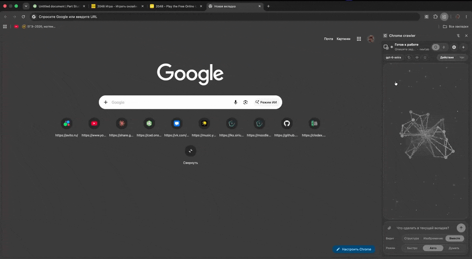
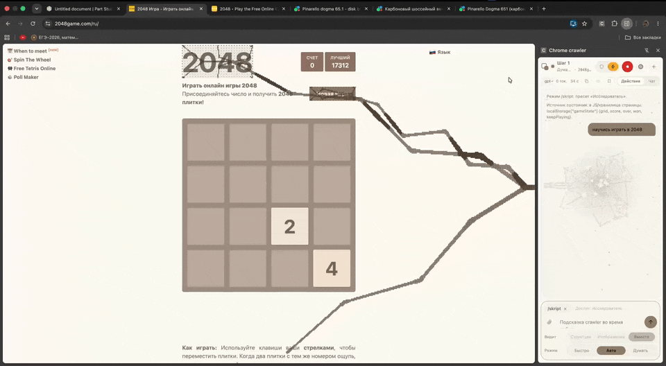
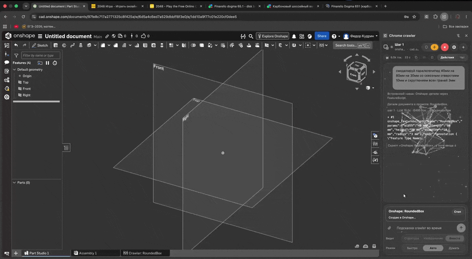
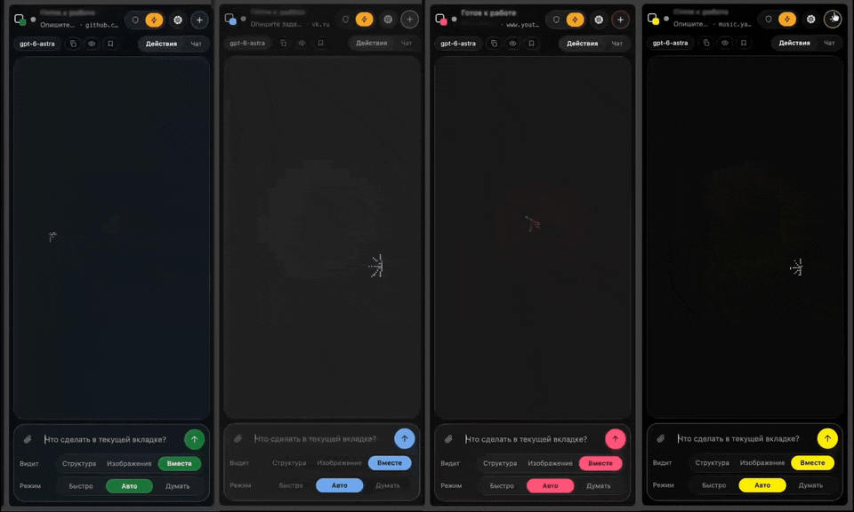
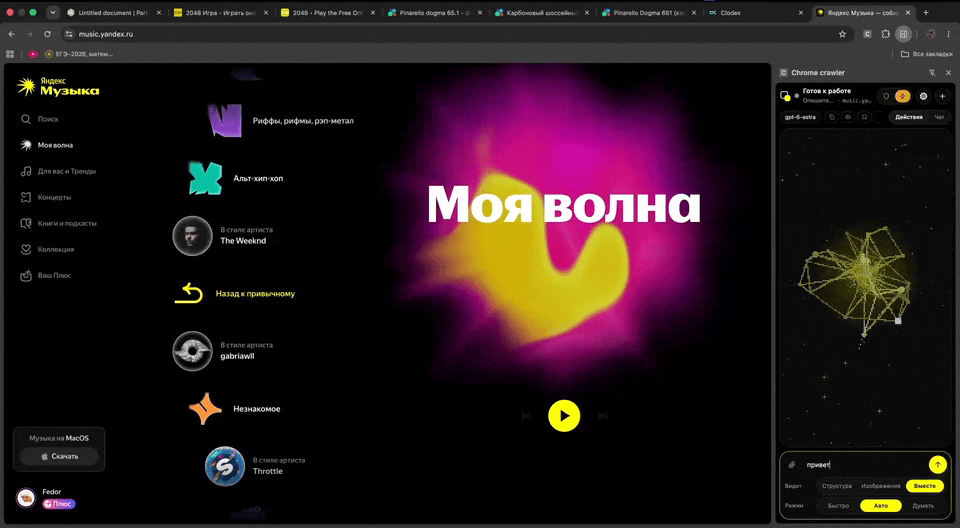

# Chrome crawler

**Агент в боковой панели Chrome: модель управляет открытой вкладкой, а где кликать долго — пишет свой скрипт.**

  

- Задача обычными словами — агент читает страницу, кликает, печатает, листает. Ввод идёт через Chrome DevTools Protocol, сайт видит его как настоящий.
- Облачные модели и **локальные** (LM Studio, Ollama, llama.cpp, Jan, vLLM). Чистый JavaScript, без сборки и зависимостей.
- Покупка, отправка, удаление — только после вашего подтверждения.

## Установка

1. **Code → Download ZIP**, распаковать.
2. `chrome://extensions` → **«Режим разработчика»** → **«Загрузить распакованное»** → папка с `manifest.json`.
3. Иконка расширения открывает панель. Клик по названию модели в шапке — провайдер, ключ, модель (локальным ключ не нужен).

**Обновление:** когда на GitHub выходит новая версия, в шапке появляется **«↑ 0.x»** → **«Обновиться»**: расширение само скачает её и перезапустится (в первый раз попросит выбрать свою папку). Настройки и скрипты сохраняются.

## Поиск товаров

*«Найди 5 самых дешёвых горных велосипедов, без запчастей»* (как в гифке вверху) — агент собирает всю выдачу одним вызовом и отвечает списком: ссылка, цена, фото. **«Ещё»** — следующие без повторов, **«хорошо / плохо»** — оценка ответа.

## /skript — скрипт вместо кликов

`/skript научись играть в 2048` — модель пишет программу, вы нажимаете **«Запустить»**, дальше она работает внутри страницы на полной скорости, без вызовов модели между ходами.

- Откуда читать игру, расширение определяет само: состояние в коде страницы, клетки в DOM или **только картинка** (canvas — по пикселям).
- Код проверяется до запуска: политика безопасности, синтаксис, пробный прогон без ввода.
- **«Работает»** — задача закончена, скрипт играет дальше сам; **«Не работает»** — модель исправляет. Рабочий скрипт можно **сохранить для сайта** и запускать без модели.

  

## Onshape — деталь из текста

*«Параллелепипед 40×80×30 со сквозным отверстием 10 мм и скруглением 3 мм»* — модель пишет FeatureScript, расширение создаёт фичу в открытом документе через Onshape API (без отдельных ключей). Каждую построенную версию проверяете вы: «Работает» / «Не работает».

  

## Панель

  

**Мозг** в центре реагирует на ввод, размышление, подтверждения и ошибки; если зажать мышь на пустом поле — хватает курсор. **Щупальца** (декоративные) «выкачивают» страницу, пока агент её читает; вёрстку не трогают, перед снимками экрана прячутся. Вид и выключение — в настройках «Движение».

  

| Режим | Что делает |
|---|---|
| **Задача** | действует по шагам, перед рискованным спрашивает |
| **Вопрос** | читает страницу и отвечает, ничего не трогая |
| **/skript** | пишет скрипт под страницу, вы одобряете — он работает сам |
| **/study** | изучает сайт под вашу цель и сохраняет стратегию |

«Видит»: **Структура** (DOM и текст), **Изображение** (скриншоты), **Вместе**. К задаче можно приложить картинки и текстовые файлы.

## Требования и приватность

- Chrome 114+ (или Chromium с Side Panel API). Любой OpenAI-совместимый провайдер или локальный сервер; желательна модель с вызовом инструментов, для картинок — с vision.
- Разрешение `debugger`: пока агент работает, Chrome показывает плашку; вкладкой с открытыми DevTools управлять нельзя.
- Скриншоты уходят вашему провайдеру модели — на личных страницах включайте «Структура». Снимки для скриптов (`pixels`/`grid`) из браузера не уходят. Настройки и скрипты хранятся локально.
- Интерфейс на русском.

## Для разработчиков

`panel/` — боковая панель, `art/` — мозг, `page/` — код во вкладке, `skript/` — режим `/skript` и Onshape, `docs/` — заметки ([поиск](docs/SEARCH_NOTES.md), [анимации](docs/MOTION.md)). Тесты рядом с модулями, все разом — `./test.sh`. История — [CHANGELOG.md](CHANGELOG.md).

## Лицензия

[CC BY-NC 4.0](LICENSE) © 2026 [ir00nman](https://github.com/ir00nman). Пользоваться, изменять и делиться можно с указанием автора и не в коммерческих целях. **Продавать проект или его изменённые версии нельзя** без отдельного разрешения автора. Это относится ко всем версиям в истории репозитория, включая ранние коммиты.
